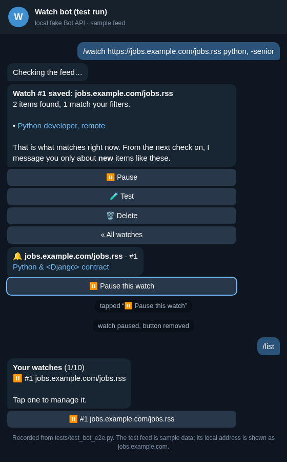

# telegram-watch-bot

A Telegram bot that watches RSS/Atom feeds, web pages and JSON APIs and sends you a message when
a new item matches your keywords. You can also describe what you want in plain words
("remote Python work, budget over $200") and let Claude decide whether each new item fits.

This is a personal portfolio project by Sunnatulla E. All test data in `tests/fixtures/` is
made up.

> **How it was tested:** I did not register a bot with @BotFather for this project. The
> Telegram side runs against a local fake Bot API server (`tests/fake_telegram.py`): aiogram
> really long-polls it, and the tests check every message and button the bot sends. To use it
> with Telegram itself you set a real `TELEGRAM_BOT_TOKEN`; I have not run that step myself.



The picture is drawn from a real test run (`tests/test_bot_e2e.py`, fake Bot API, sample feed).
The local test server's address is shown as `jobs.example.com`. To redraw it:

```bash
TGWATCH_TRANSCRIPT=/tmp/chat.json uv run pytest -k one_line_watch
uv run python scripts/render_transcript.py /tmp/chat.json /tmp/chat.html
```

Then open `/tmp/chat.html` in a browser and take a 560 px wide screenshot.

## Features

- **Chat commands with buttons**: `/watch` (step by step, or one line for feeds), `/list` with a
  card per watch (Pause / Resume, Test, Delete with confirmation), `/test` dry run that shows
  what would alert right now, `/pause`, `/resume`, `/unwatch`, admin-only `/stats`.
- **Alerts** with the item title as a link, extra fields such as price, the AI reason when the
  filter is on, and a "Pause this watch" button. Telegram's flood limits are respected (one
  message per second per chat, `retry_after` honoured). If a user blocks the bot, their watches
  are paused instead of failing forever.
- **Limits** so one person cannot overload a shared bot: watches per chat (10 by default), a
  short cooldown between dry runs, 5 minutes minimum between checks.
- **Three kinds of source**
  - `rss`: RSS 2.0 and Atom feeds (feedparser)
  - `html`: any page, with a CSS selector for the items and optional selectors for title, link
    and extra fields such as price (selectolax / lexbor)
  - `json`: JSON APIs, with a small JSONPath subset to the item list (`data.children[*].data`)
- **Keyword rules** typed the way people type: `python, "full stack", -senior, react*`.
  Word-aware, so `java` does not match "JavaScript" unless you write `java*`.
- **Optional Claude filter**: natural-language criteria, one yes/no verdict plus a one-line reason
  per new item, using structured outputs. Without an API key the bot runs on keywords only. If
  the API fails, the item is still sent and marked "AI check unavailable" so nothing is lost.
- **No alert flood**: the first check of a new watch only records what is already there.
- **Polite fetching**: honest User-Agent, robots.txt (RFC 9309 rules), at most one request per
  host every 2 s, retries with exponential backoff and `Retry-After`, ETag / Last-Modified
  conditional requests, 5 MB response cap, 20 s timeout, 5 minute minimum interval per watch.
- **Safe for a public bot**: only http(s), and URLs that resolve to localhost, private networks
  or cloud metadata addresses are refused, on every redirect hop too.
- **Reliable delivery**: an item is marked as seen only after its alert was sent. Failing watches
  back off (5, 10, 20 min ... up to 6 h) and the owner is told once, on the third failure in a row.
- SQLite storage (aiosqlite, WAL), schema versioning, seen-item pruning per watch.

## Stack

Python 3.12, aiogram 3 (long polling, FSM for the setup dialog, callback data factories), httpx, feedparser, selectolax, aiosqlite, pydantic-settings, Anthropic
Python SDK. Tests: pytest with a local aiohttp site whose content changes between polls, a fake
Telegram Bot API server the real bot polls, and a local stand-in for the Messages API so the AI
tests need no key. Ruff and mypy `--strict`.

## Run the bot

You need Python 3.12 with [uv](https://docs.astral.sh/uv/) and a bot token from @BotFather.

```bash
uv sync
cp .env.example .env    # put TELEGRAM_BOT_TOKEN in it
uv run tgwatch run
```

Or with Docker: `docker compose up -d --build` (the SQLite database lives in a named volume).
I wrote the Dockerfile but could not build it on the machine I used; the same `uv sync --frozen
--no-dev` install was checked outside Docker.

Then talk to the bot:

```
/watch https://github.com/aiogram/aiogram/releases.atom fix*, -beta
/list
/test 1
```

For a web page, send `/watch` without arguments and pick "Web page": the bot asks for a CSS
selector for the items (`li.card`) and optional fields (`title=h3`, `price=.price`). For a JSON
API it asks for the path to the item list (`data.items`). Every new watch is checked once before
it is saved, so a wrong selector is caught right away.

With `ANTHROPIC_API_KEY` set, the setup also asks for plain-language criteria ("remote, budget
over $500") and Claude judges each new item. The default model is `claude-opus-5-5`; set
`ANTHROPIC_MODEL` to change it. Put your own Telegram user id in `ADMIN_CHAT_IDS` to use `/stats`.

## Try a watch without Telegram

```bash
uv run tgwatch check https://github.com/aiogram/aiogram/releases.atom --limit 3
uv run tgwatch check "https://api.github.com/repos/aiogram/aiogram/releases?per_page=5" \
  --kind json --field tag=tag_name --keywords "bot api"
uv run tgwatch check "https://example.com/listings" --kind html --items "li.card" \
  --field title=.card__title --field price=.card__price --keywords "bike*, -kids"
```

Add `--criteria "under 500 USD, not for kids"` to see the AI verdicts (needs the API key).

Only watch pages whose terms allow automated access. The bot honours robots.txt, but terms of
service are up to you.

## Development

```bash
uv sync
uv run pytest
uv run ruff check . && uv run ruff format --check .
uv run mypy
```

## Layout

```
src/tgwatch/
  fetch.py       HTTP client: retries, pacing, robots.txt, private-host guard, size cap
  parsers.py     RSS/Atom, HTML (CSS selectors) and JSON (path) to Item
  jsonpath.py    the small JSONPath subset
  filters.py     keyword rules
  ai_filter.py   Claude relevance filter (structured output)
  store.py       SQLite: watches and seen items
  engine.py      one check of one watch
  scheduler.py   polling loop, delivery, error backoff
  cli.py         `tgwatch run` and `tgwatch check`
  bot/
    app.py       wiring: Bot, Dispatcher, scheduler in one asyncio process
    handlers.py  commands, step-by-step /watch, button callbacks
    service.py   validation, per-chat limits, create / test a watch
    notifier.py  alerts through the Bot API with flood control
    keyboards.py inline buttons
    texts.py     message formatting (everything from websites is HTML-escaped)
tests/
  fake_telegram.py  local Bot API stand-in used by test_bot_e2e.py
scripts/
  render_transcript.py  turns a test chat transcript into the HTML behind docs/chat.png
```

## Known limits

- Private chats only. Alerts into groups or channels are not built yet.
- The setup dialog state is kept in memory, so a restart in the middle of `/watch` means
  starting that one again. Saved watches are in SQLite and survive restarts.
- The private-address check resolves the host before the request; a hostile DNS server could
  still answer differently a moment later (DNS rebinding). Run a public instance on a host with
  no sensitive services on its private network.
- Pages that render their content with JavaScript are not supported; use their RSS feed or JSON
  API instead.

## Other Telegram bots I made

If you need a different kind of bot, I also sell two ready-made Python Telegram bot kits with
full source: a [shop bot with an admin panel](https://sunnatulladev.gumroad.com/l/telegram-shop-bot-python)
and an [AI assistant bot (OpenAI + Claude)](https://sunnatulladev.gumroad.com/l/telegram-ai-assistant-bot).
This repository is free and separate from them.

## License

MIT
